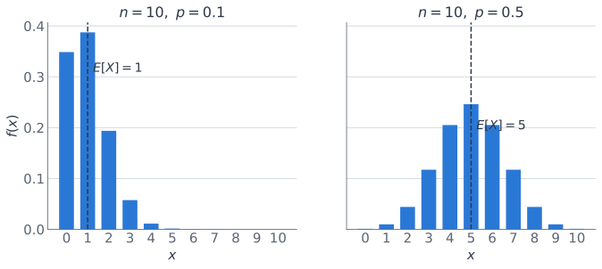
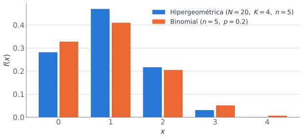
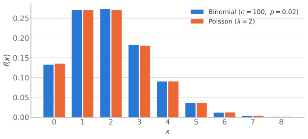
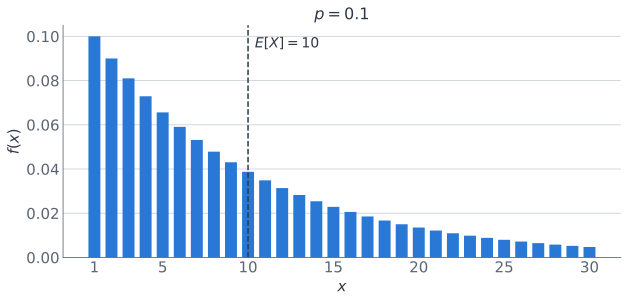

# Variables aleatorias discretas {style="margin-top: 45px; font-size: 1.2em;"}

<h3 style="font-size: 1.0em;"> Función de probabilidad, valor esperado y distribuciones discretas </h3>

<h4 style="font-size: 0.6em; opacity: 0.6"> Noviembre 2026 </h4>

## Unidades temáticas {background-color="#e4e4e7" style="font-size: 1.0em;"}

- **Unidad 1:** Definiciones. Manejo de datos y medidas estadísticas
- **Unidad 2:** Probabilidad y muestreo
- **Unidad 3:** Variables aleatorias discretas y continuas y sus distribuciones
- **Unidad 4:** Distribuciones muestrales. Introducción a los intervalos de confianza
- **Unidad 5:** Análisis de regresión y correlación

## Variables aleatorias discretas {background-color="#e4e4e7" style="font-size: 1.0em;"}

**1.** Variable aleatoria discreta

**2.** Valor esperado y varianza

**3.** Distribución uniforme discreta

**4.** Distribución binomial

**5.** Distribución hipergeométrica

**6.** Distribución de Poisson

**7.** Distribuciones geométrica y binomial negativa

**8.** Elección de la distribución

# Variable aleatoria discreta {background-color="#2d3748"}

Asigna un número a cada resultado de un experimento aleatorio. Es discreta cuando sus valores se pueden listar.

## Elementos de la variable aleatoria discreta {background-color="#e2e8f0"}

* **Variable aleatoria** | Función que asigna un número a cada resultado del experimento.

* **Función de probabilidad** | $f(x)=P(X=x)$: suma las probabilidades de los resultados que dan el valor $x$.

* **Función de distribución acumulada** | $F(x)=P(X\le x)$: acumula $f$ hasta el valor $x$.

* **Limitación** | En una variable discreta, $P(X\le a)$ y $P(X<a)$ son distintas.

## Construcción de la función de probabilidad {.smaller background-color="#e2e8f0"}

Cada soldadura de campo tiene porosidad con probabilidad $0.1$, independientemente de las demás. Se inspeccionan 3 soldaduras ($B$ = sin porosidad, $P$ = con porosidad) y $X$ es el número con porosidad.

| Resultado          | Probabilidad de cada resultado | $X$ |
| :----------------: | :----------------------------: | :-: |
| $BBB$              | $0.9^3 = 0.729$                | 0   |
| $BBP,\ BPB,\ PBB$  | $0.1 \times 0.9^2 = 0.081$     | 1   |
| $BPP,\ PBP,\ PPB$  | $0.1^2 \times 0.9 = 0.009$     | 2   |
| $PPP$              | $0.1^3 = 0.001$                | 3   |

::: {style="border-left: 2px solid #888; padding-left: 15px; line-height: 1.8; margin-top: 20px;"}
$X$ agrupa los 8 resultados posibles en 4 valores.
:::

## Cuantificación de la variable aleatoria discreta {background-color="#e2e8f0"}

Para la inspección de las 3 soldaduras:

| $x$    | 0     | 1     | 2     | 3     |
| ------ | :---: | :---: | :---: | :---: |
| $f(x)$ | 0.729 | 0.243 | 0.027 | 0.001 |
| $F(x)$ | 0.729 | 0.972 | 0.999 | 1     |

En general, para valores enteros $a\le b$:

$$ \sum_x f(x)=1, \qquad P(a\le X\le b)=F(b)-F(a-1) $$

## Caso de estudio [(frentes con retraso)]{style="font-size: 65%;"} {background-color="#f2f2f2"}

Una obra tiene 6 frentes de trabajo, 2 de ellos con retraso. Un supervisor visita 3 frentes escogidos al azar. Sea $X$ el número de frentes con retraso entre los visitados.

a) Obtenga la función de probabilidad de $X$ y verifique que suma 1.

b) Construya la función de distribución acumulada.

c) ¿Cuál es la probabilidad de que el supervisor visite al menos un frente con retraso?

# Valor esperado y varianza {background-color="#2d3748"}

Resumen el centro y la dispersión de una variable aleatoria.

## Elementos del valor esperado y la varianza {background-color="#e2e8f0"}

* **Valor esperado** | Promedio de los valores ponderado por sus probabilidades. Es el promedio a largo plazo.

* **Varianza** | Promedio ponderado de las desviaciones al cuadrado respecto del valor esperado.

* **Transformación lineal** | Si $Y=aX+b$, la constante $b$ desplaza el valor esperado pero no cambia la varianza.

* **Limitación** | El valor esperado no tiene por qué ser un valor posible de $X$.

## Cuantificación del valor esperado y la varianza {.smaller background-color="#e2e8f0"}

$$ E[X]=\sum_x x\,f(x), \qquad \mathrm{Var}(X)=\sum_x x^2 f(x)-E[X]^2, \qquad \mathrm{Var}(aX+b)=a^2\,\mathrm{Var}(X) $$

Para la inspección de las 3 soldaduras:

$$ E[X]=0(0.729)+1(0.243)+2(0.027)+3(0.001)=0.3 $$

$$ \mathrm{Var}(X)=0.36-0.3^2=0.27 $$

::: {style="border-left: 2px solid #888; padding-left: 15px; line-height: 1.8; margin-top: 20px;"}
Estos valores coinciden con $3\times 0.1$ y $3\times 0.1\times 0.9$, como se verá en la distribución binomial.
:::

## Aplicaciones del valor esperado y la varianza {background-color="#e2e8f0"}

* **Presupuesto de obra** | Se estima el costo esperado de reparaciones a partir del número probable de fallas.

* **Programación** | Se calculan los días de lluvia esperados por mes y su variabilidad para definir holguras.

* **Mantenimiento** | Se estima el número esperado de intervenciones de un equipo durante su vida útil.

* **Control de calidad** | Se compara la dispersión del número de defectos entre dos proveedores.

* **Seguros y garantías** | Se calcula el costo esperado de las garantías de un lote de elementos prefabricados.

## Caso de estudio [(días de obra detenida)]{style="font-size: 65%;"} {background-color="#f2f2f2"}

El número $X$ de días por semana en que la lluvia detiene una obra tiene la siguiente función de probabilidad:

| $x$    |   0 |   1 |   2 |   3 |
| ------ | --: | --: | --: | --: |
| $f(x)$ | 0.4 | 0.3 | 0.2 | 0.1 |

a) Calcule el valor esperado y la varianza de $X$.

b) Cada día detenido cuesta 2 millones de pesos y cada semana hay un costo fijo de 1 millón. Calcule el costo semanal esperado y su desviación estándar.

# Distribución uniforme discreta {background-color="#2d3748"}

Todos los valores de un rango de enteros tienen la misma probabilidad.

## Supuestos de la distribución uniforme discreta {background-color="#e2e8f0"}

* **Rango** | Los valores posibles son los enteros consecutivos $a, a+1, \ldots, b$.

* **Equidad** | Cada valor tiene la misma probabilidad.

* **Limitación** | No describe variables cuyos valores tienden a concentrarse, como el número de fallas.

## Cuantificación de la distribución uniforme discreta {background-color="#e2e8f0"}

$$ f(x)=\frac{1}{b-a+1}, \qquad x=a,\ldots,b $$

$$ E[X]=\frac{a+b}{2}, \qquad \mathrm{Var}(X)=\frac{(b-a+1)^2-1}{12} $$

## Aplicaciones de la distribución uniforme discreta {background-color="#e2e8f0"}

* **Auditoría** | Se sortea cuál de varias cuadrillas numeradas será auditada.

* **Muestreo** | Se escoge al azar cuál de varias soldaduras numeradas se envía al laboratorio.

* **Simulación** | Se generan números al azar para asignar turnos o frentes de trabajo.

## Caso de estudio [(sorteo de cuadrillas)]{style="font-size: 65%;"} {background-color="#f2f2f2"}

Para una auditoría se sortea una de 10 cuadrillas, numeradas del 1 al 10. Sea $X$ el número de la cuadrilla sorteada.

a) Calcule el valor esperado y la varianza de $X$.

b) ¿Cuál es la probabilidad de que salga una de las tres primeras cuadrillas?

# Distribución binomial {background-color="#2d3748"}

Cuenta los éxitos en un número fijo de ensayos independientes con la misma probabilidad de éxito.

## Supuestos de la distribución binomial {background-color="#e2e8f0"}

* **Número fijo de ensayos** | Se decide de antemano cuántos ensayos se realizan: $n$.

* **Dos resultados** | Cada ensayo termina en éxito o fracaso.

* **Independencia** | El resultado de un ensayo no cambia los demás.

* **Probabilidad constante** | Todos los ensayos tienen la misma probabilidad de éxito: $p$.

* **Limitación** | Si los ensayos se influyen entre sí, como en un muestreo sin reemplazo de un lote pequeño, no aplica.

## Cuantificación de la distribución binomial {.smaller background-color="#e2e8f0"}

En la inspección de las 3 soldaduras, $X=1$ agrupa 3 resultados ($BBP$, $BPB$, $PBB$), cada uno con probabilidad $0.1\times 0.9^2$:

$$ P(X=1)=3\times 0.1^1\,0.9^2=0.243 $$

Con $n$ ensayos hay $\binom{n}{x}$ resultados con $x$ éxitos, cada uno con probabilidad $p^x(1-p)^{n-x}$:

$$ f(x)=\binom{n}{x}p^x(1-p)^{n-x}, \qquad E[X]=np, \qquad \mathrm{Var}(X)=np(1-p) $$

::: {style="border-left: 2px solid #888; padding-left: 15px; line-height: 1.8; margin-top: 20px;"}
Con $n=3$ y $p=0.1$ se obtienen $E[X]=0.3$ y $\mathrm{Var}(X)=0.27$.
:::

## Forma de la distribución binomial {.smaller background-color="#e2e8f0"}

{fig-align="center" width="75%"}

::: {style="border-left: 2px solid #888; padding-left: 15px; line-height: 1.8; margin-top: 20px;"}
Con $p$ pequeña, la probabilidad se concentra cerca de 0. Con $p=0.5$, la distribución es simétrica alrededor de $np$.
:::

## Aplicaciones de la distribución binomial {background-color="#e2e8f0"}

* **Control de calidad** | Número de probetas que no cumplen la resistencia entre las ensayadas.

* **Estructuras metálicas** | Número de soldaduras con porosidad entre las inspeccionadas.

* **Confiabilidad** | Número de cables que resisten en un sistema redundante.

* **Tránsito** | Número de vehículos pesados entre los que llegan a un peaje.

* **Cimentaciones** | Número de pilotes que superan la prueba de integridad.

## Caso de estudio [(reparación de pilotes)]{style="font-size: 65%;"} {background-color="#f2f2f2"}

Una cimentación tiene 8 pilotes. Cada pilote requiere reparación con probabilidad 0.1, independientemente de los demás.

a) ¿Cuál es la probabilidad de que ningún pilote requiera reparación?

b) ¿Cuál es la probabilidad de que al menos 2 pilotes requieran reparación?

c) ¿Cuántos pilotes se espera reparar?

# Distribución hipergeométrica {background-color="#2d3748"}

Cuenta los éxitos en una muestra tomada sin reemplazo de un lote finito de composición conocida.

## Elementos de la distribución hipergeométrica {background-color="#e2e8f0"}

* **Lote y muestra** | $N$ elementos, $K$ con la característica y una muestra de $n$ sin reemplazo.

* **Dependencia** | Cada extracción cambia la composición de lo que queda.

* **Relación con la binomial** | Cuenta lo mismo, pero sin independencia entre extracciones.

* **Limitación** | Requiere conocer la composición del lote.

## Cuantificación de la distribución hipergeométrica {background-color="#e2e8f0"}

$$ f(x)=\frac{\binom{K}{x}\binom{N-K}{n-x}}{\binom{N}{n}}, \qquad E[X]=n\frac{K}{N} $$

$$ \mathrm{Var}(X)=n\frac{K}{N}\left(1-\frac{K}{N}\right)\frac{N-n}{N-1} $$

::: {style="border-left: 2px solid #888; padding-left: 15px; line-height: 1.8; margin-top: 20px;"}
El factor $\frac{N-n}{N-1}$ es la corrección por población finita. Si $n/N\le 0.05$, la binomial con $p=K/N$ es una buena aproximación.
:::

## Comparación entre la hipergeométrica y la binomial {.smaller background-color="#e2e8f0"}

Lote de 20 soldaduras prefabricadas, 4 con porosidad, y una muestra de 5:

{fig-align="center" width="70%"}

::: {style="border-left: 2px solid #888; padding-left: 15px; line-height: 1.8; margin-top: 20px;"}
Con $n/N=0.25$ las diferencias son apreciables. Sin reemplazo, los valores extremos son menos probables.
:::

## Aplicaciones de la distribución hipergeométrica {background-color="#e2e8f0"}

* **Planes de aceptación** | Probabilidad de aceptar un lote según la muestra inspeccionada.

* **Recepción de materiales** | Número de sacos humedecidos en una muestra de un despacho.

* **Auditoría** | Número de proyectos con hallazgos en una muestra de la cartera.

* **Inspección estructural** | Número de elementos fisurados en una muestra de un pórtico.

* **Exploración geotécnica** | Número de sondeos sorteados que caen en una zona de relleno.

## Caso de estudio [(inspección de vigas)]{style="font-size: 65%;"} {background-color="#f2f2f2"}

Un pórtico tiene 18 vigas, 3 de ellas con defectos. Se inspeccionan 4 vigas escogidas al azar.

a) ¿Cuál es la probabilidad de no encontrar vigas defectuosas?

b) El pórtico se aprueba si se encuentra a lo sumo una viga defectuosa. ¿Cuál es la probabilidad de aprobarlo?

c) ¿Cuántas vigas defectuosas se espera encontrar? ¿Sería razonable usar la binomial en este caso?

# Distribución de Poisson {background-color="#2d3748"}

Cuenta los eventos que ocurren en un intervalo de tiempo, longitud, área o volumen.

## Supuestos de la distribución de Poisson {background-color="#e2e8f0"}

* **Independencia** | La ocurrencia de un evento no cambia la de los demás.

* **Tasa constante** | El número promedio de eventos por unidad no cambia a lo largo del intervalo.

* **Eventos aislados** | Dos eventos no ocurren exactamente en el mismo instante o punto.

* **Relación con la binomial** | Es el límite de la binomial con muchos ensayos y probabilidad de éxito muy pequeña.

* **Limitación** | Si la tasa cambia, por ejemplo entre temporadas, una sola $\lambda$ no describe el fenómeno.

## Cuantificación de la distribución de Poisson {.smaller background-color="#e2e8f0"}

Si $\lambda$ es el número promedio de eventos en el intervalo considerado:

$$ f(x)=\frac{e^{-\lambda}\lambda^x}{x!}, \qquad x=0,1,2,\ldots, \qquad E[X]=\mathrm{Var}(X)=\lambda $$

Aproximación de la binomial con $n$ grande y $p$ pequeña:

$$ \binom{n}{x}p^x(1-p)^{n-x}\approx\frac{e^{-\lambda}\lambda^x}{x!}, \qquad \lambda=np $$

::: {style="border-left: 2px solid #888; padding-left: 15px; line-height: 1.8; margin-top: 20px;"}
$\lambda$ debe corresponder al intervalo de la pregunta: $\lambda=\text{tasa}\times\text{tamaño del intervalo}$. Como guía, la aproximación es buena si $n\ge 20$ y $p\le 0.05$.
:::

## Aproximación de la binomial por la Poisson {.smaller background-color="#e2e8f0"}

Un metro de cordón de soldadura dividido en 100 tramos de 1 cm, cada uno con defecto con probabilidad 0.02:

{fig-align="center" width="70%"}

::: {style="border-left: 2px solid #888; padding-left: 15px; line-height: 1.8; margin-top: 20px;"}
Las dos distribuciones son casi idénticas. La Poisson solo necesita el promedio $\lambda=np=2$.
:::

## Aplicaciones de la distribución de Poisson {background-color="#e2e8f0"}

* **Tránsito** | Llegadas de vehículos a una báscula o accidentes en una intersección.

* **Redes de acueducto** | Fisuras por kilómetro de tubería o daños reportados por día.

* **Pavimentos y losas** | Defectos superficiales por metro cuadrado.

* **Estructuras metálicas** | Defectos por metro de cordón de soldadura.

* **Hidrología** | Número de lluvias intensas por semana en temporada seca.

## Caso de estudio [(lluvias intensas)]{style="font-size: 65%;"} {background-color="#f2f2f2"}

En temporada seca, una zona registra en promedio 0.75 lluvias intensas por semana, con tasa constante.

a) ¿Cuál es la probabilidad de que en una semana no haya lluvias intensas?

b) ¿Cuál es la probabilidad de que en 4 semanas haya a lo sumo una?

c) ¿Por qué no podría usarse la misma tasa para calcular probabilidades en temporada de lluvias?

# Distribuciones geométrica y binomial negativa {background-color="#2d3748"}

Cuentan los ensayos necesarios hasta obtener el primer éxito o el $r$-ésimo éxito.

## Número fijo de ensayos y número fijo de éxitos {background-color="#e2e8f0" style="font-size: 1.0em;"}

::: {.columns}

::: {.column style="width: 50%; font-size: 0.85em; border: none; border-radius: 0px; padding: 1.25rem; transition: background-color 0.25s ease, transform 0.25s ease;" onmouseover="this.style.backgroundColor='#f7fafc'; this.style.transform='translateY(-3px)';" onmouseout="this.style.backgroundColor='transparent'; this.style.transform='translateY(0px)';"}
### Binomial

Se fija cuántos ensayos se realizan.

- **Cuenta:** Los éxitos en $n$ ensayos.
- **Valores:**
  
$$x=0,1,\ldots,n$$

- **Ejemplo:** De 10 soldaduras inspeccionadas, ¿cuántas tienen porosidad?
:::

::: {.column style="width: 50%; font-size: 0.85em; border: none; border-radius: 0px; padding: 1.25rem; transition: background-color 0.25s ease, transform 0.25s ease;" onmouseover="this.style.backgroundColor='#f7fafc'; this.style.transform='translateY(-3px)';" onmouseout="this.style.backgroundColor='transparent'; this.style.transform='translateY(0px)';"}
### Geométrica y binomial negativa

Se fija cuántos éxitos se esperan.

- **Cuenta:** Los ensayos hasta el $r$-ésimo éxito.
- **Valores:**
  
$$x=r,r+1,\ldots$$

- **Ejemplo:** ¿Cuántas soldaduras hay que inspeccionar hasta encontrar una con porosidad?
:::

:::

## Elementos de las distribuciones geométrica y binomial negativa {background-color="#e2e8f0"}

* **Geométrica** | Número de ensayos hasta el primer éxito, incluido ese ensayo.

* **Binomial negativa** | Número de ensayos hasta el $r$-ésimo éxito. El último ensayo es siempre un éxito.

* **Falta de memoria** | En la geométrica, los fracasos anteriores no cambian la probabilidad del siguiente ensayo.

* **Relación con la binomial** | Mismos ensayos independientes, pero se fija el número de éxitos en lugar del número de ensayos.

* **Limitación** | Algunos textos cuentan fracasos en lugar de ensayos, y las fórmulas se desplazan.

## Cuantificación de las distribuciones geométrica y binomial negativa {.smaller background-color="#e2e8f0"}

Geométrica:

$$ f(x)=(1-p)^{x-1}p, \qquad P(X>x)=(1-p)^x, \qquad E[X]=\frac{1}{p}, \qquad \mathrm{Var}(X)=\frac{1-p}{p^2} $$

Binomial negativa:

$$ f(x)=\binom{x-1}{r-1}p^r(1-p)^{x-r}, \qquad E[X]=\frac{r}{p}, \qquad \mathrm{Var}(X)=\frac{r(1-p)}{p^2} $$

::: {style="border-left: 2px solid #888; padding-left: 15px; line-height: 1.8; margin-top: 20px;"}
En la binomial negativa, el último ensayo es el éxito número $r$ y los otros $r-1$ éxitos se ubican entre los $x-1$ ensayos anteriores.
:::

## Forma de la distribución geométrica {.smaller background-color="#e2e8f0"}

Número de soldaduras inspeccionadas hasta encontrar la primera con porosidad:

{fig-align="center" width="70%"}

::: {style="border-left: 2px solid #888; padding-left: 15px; line-height: 1.8; margin-top: 20px;"}
En promedio se inspeccionan 10 soldaduras, pero $P(X>20)=0.9^{20}\approx 0.12$.
:::

## Aplicaciones de las distribuciones geométrica y binomial negativa {background-color="#e2e8f0"}

* **Exploración** | Número de sondeos hasta encontrar agua subterránea.

* **Laboratorio** | Número de probetas por ensayar hasta reunir las que cumplen.

* **Inspección** | Número de soldaduras revisadas hasta encontrar la primera defectuosa.

* **Comunicaciones** | Número de intentos de conexión de un equipo de campo.

* **Alertas tempranas** | Número de muestras analizadas hasta detectar la segunda contaminada.

## Caso de estudio [(lecturas de un equipo)]{style="font-size: 65%;"} {background-color="#f2f2f2"}

Cada lectura de un equipo de medición en campo es aceptada con probabilidad 0.75, independientemente de las demás.

a) ¿Cuál es la probabilidad de que la primera lectura aceptada sea la tercera?

b) Se necesitan 2 lecturas aceptadas. ¿Cuál es la probabilidad de que la segunda llegue exactamente en la cuarta lectura?

c) ¿Cuántas lecturas se esperan hasta reunir las 2 aceptadas?

# Elección de la distribución {background-color="#2d3748"}

Depende del mecanismo que genera los datos: qué está fijo y qué cuenta la variable.

## Elección de la distribución {.smaller background-color="#e2e8f0"}

| Qué está fijo                         | Qué cuenta $X$ | Distribución       |
| ------------------------------------- | -------------- | ------------------ |
| Un rango de valores equiprobables     | un valor       | Uniforme discreta  |
| Número de ensayos independientes      | éxitos         | Binomial           |
| Muestra sin reemplazo de lote pequeño | éxitos         | Hipergeométrica    |
| Tamaño de un intervalo                | eventos        | Poisson            |
| Un éxito esperado                     | ensayos        | Geométrica         |
| $r$ éxitos esperados                  | ensayos        | Binomial negativa  |

::: {style="border-left: 2px solid #888; padding-left: 15px; line-height: 1.8; margin-top: 20px;"}
Binomial e hipergeométrica cuentan lo mismo. Las distingue el mecanismo: ensayos independientes o muestreo sin reemplazo.
:::

## Caso de estudio [(inspección de soldaduras)]{style="font-size: 65%;"} {.smaller background-color="#f2f2f2"}

En una estructura metálica, cada soldadura de campo tiene porosidad con probabilidad 0.1, independientemente de las demás. Identifique la distribución y calcule la probabilidad pedida.

a) De 10 soldaduras de campo inspeccionadas, exactamente 2 tienen porosidad.

b) De un lote de 20 soldaduras prefabricadas con 4 defectuosas, se inspeccionan 5 y ninguna es defectuosa.

c) Un cordón de 5 m, con 0.4 defectos por metro, no tiene defectos.

d) Se deben inspeccionar más de 20 soldaduras de campo para encontrar la primera con porosidad.

e) La segunda soldadura con porosidad aparece exactamente en la décima inspeccionada.

::: {background-image="image_files/fallingdices.jpg" background-size="cover"}

#

[Foto por <a href="https://unsplash.com/@jogaway?utm_source=unsplash&utm_medium=referral&utm_content=creditCopyText">Jonathan Greenaway</a> on <a href="https://unsplash.com/photos/a-group-of-dices-flying-in-the-air-TNUEQ73frkA?utm_source=unsplash&utm_medium=referral&utm_content=creditCopyText">Unsplash</a>]{.footer}

::: {style="text-align: center; margin-top: 5%;"}
::: {style="display: inline-block; background: rgba(0, 0, 0, 0.55); backdrop-filter: blur(8px); -webkit-backdrop-filter: blur(8px); padding: 30px 40px; border-radius: 12px; border: 1px solid rgba(255, 255, 255, 0.15); font-size: 1.2em; color: #ffffff; max-width: 90%;"}
**Una distribución no se elige por el tema del problema, sino por el mecanismo que genera los datos.**
:::
:::

:::

## Resumen de distribuciones discretas {.smaller background-color="#e2e8f0"}

| Distribución               | $f(x)$                                                   | $E[X]$          | $\mathrm{Var}(X)$                     |
| -------------------------- | -------------------------------------------------------- | :-------------: | :-----------------------------------: |
| Uniforme $\{a,\ldots,b\}$  | $\frac{1}{b-a+1}$                                        | $\frac{a+b}{2}$ | $\frac{(b-a+1)^2-1}{12}$              |
| Binomial                   | $\binom{n}{x}p^x(1-p)^{n-x}$                             | $np$            | $np(1-p)$                             |
| Hipergeométrica            | $\frac{\binom{K}{x}\binom{N-K}{n-x}}{\binom{N}{n}}$      | $n\frac{K}{N}$  | $n\frac{K}{N}(1-\frac{K}{N})\frac{N-n}{N-1}$ |
| Poisson                    | $\frac{e^{-\lambda}\lambda^x}{x!}$                       | $\lambda$       | $\lambda$                             |
| Geométrica                 | $(1-p)^{x-1}p$                                           | $\frac{1}{p}$   | $\frac{1-p}{p^2}$                     |
| Binomial negativa          | $\binom{x-1}{r-1}p^r(1-p)^{x-r}$                         | $\frac{r}{p}$   | $\frac{r(1-p)}{p^2}$                  |
